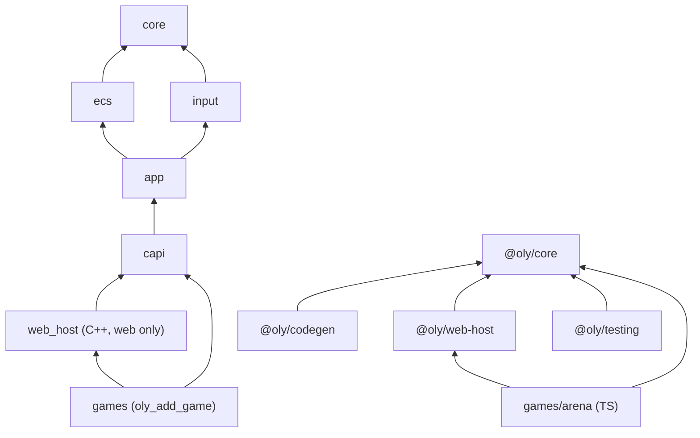

# Modules and boundaries

## Dependency graph

| Module | CMake target | `DEPENDS` | Type |
|---|---|---|---|
| `core` | `oly::core` | — | library |
| `ecs` | `oly::ecs` | `core` | library |
| `input` | `oly::input` | `core` | library |
| `app` | `oly::app` | `input ecs core` | library |
| `capi` | `oly::capi` | `app input ecs core` | `OBJECT` |
| `web_host` | `oly::web_host` | `capi` | `OBJECT`, built only with Emscripten |

`capi` and `web_host` are `OBJECT` because, in a static library, the linker would discard the unreferenced members and take the `EMSCRIPTEN_KEEPALIVE` functions with them.

## How the boundaries are enforced

The boundaries do not hold by convention alone. Three mechanisms enforce them:

1. **The build.** `oly_add_module(NAME <m> DEPENDS <...>)` links only the declared modules. `ecs` does not link `capi`, so an include of `capi` inside the ECS does not compile.
2. **The `oly.lint.boundaries` lint** (`tools/check_boundaries.py`, runs in ctest, with a self-test in `oly.lint.boundaries_selftest`). It rejects:
   - `#include "oly/<x>/..."` in a module or game that did not declare `<x>` in `DEPENDS` (dependencies are `PUBLIC` and transitive, so only the lint catches the undeclared direct include);
   - `oly/<x>/detail/` included outside `engine/runtime/<x>/` (the module's own tests and benchmarks may);
   - `@oly/core/internal` imported outside `engine/`;
   - `@oly/web-host` imported in `@oly/core`;
   - a relative import that crosses packages;
   - `engine/runtime/` including a module or importing a package of `engine/environments/`;
   - one environment including or importing another;
   - `__EMSCRIPTEN__`, `EM_*`, `EMSCRIPTEN_*` or `<emscripten.h>` outside `engine/environments/web/` and `OLY_API` (`c_api.hpp`); a test under `tests/` or a benchmark under `bench/` may use `__EMSCRIPTEN__` to skip a case on WASM.
3. **The TS surface test** (`ts.core.unit`, `surface.test.ts`). It checks the public exports of `@oly/core` against the versioned list `engine/environments/web/clients/typescript/core/api/public-exports.txt`. Adding something to the public API is an explicit change in that file.

Why `detail/` and a lint, and not pimpl: the hot-path templates (`Query<Ts...>::each`, `World::get<T>`, `World::spawn<Ts...>`) need to see `Table` and `Archetype` to inline. Hiding these types behind pimpl or a virtual interface would put indirection in the iteration loop. The compiler sees the details; the build rejects whoever uses them from outside.

## Vocabulary rules

- Game concepts (enemy, coin, dash) never enter `engine/`. Game names only appear in `engine/testing/fixture/` and in `games/`.
- The same verb holds across the three surfaces (C++, C API, TS): `spawn`, `destroy`, `add`, `remove`, `has`, `get`, `query`, `eachBlock`. The full glossary is in [glossary.md](glossary.md).
- The `oly` prefix appears only in the C API (`oly*`, `OlyWorld`, `OLY_API`) and in what is internal to `capi`. `extern "C"` symbols live in a single global namespace of the WASM module, together with libc and the game's exports; the prefix avoids collisions. The C++ (`oly::ecs::World`) and TS (`World`) APIs do not repeat `oly`.
- The `ById` suffix marks the variant by `ComponentId` at run time: `addById`, `removeById`, `hasById`, `getById`, `tryGetById`, `queryById`.
