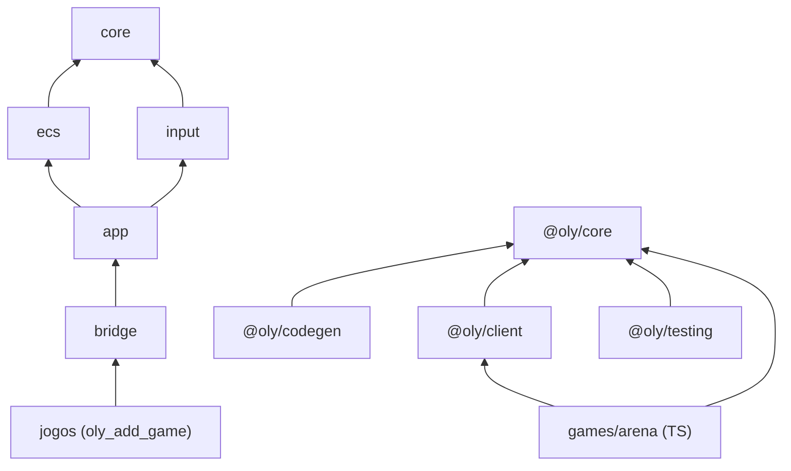

# Módulos e fronteiras

## Grafo de dependências

| Módulo | Alvo CMake | `DEPENDS` | Tipo |
|---|---|---|---|
| `core` | `oly::core` | — | biblioteca |
| `ecs` | `oly::ecs` | `core` | biblioteca |
| `input` | `oly::input` | `core` | biblioteca |
| `app` | `oly::app` | `input ecs core` | biblioteca |
| `bridge` | `oly::bridge` | `app input ecs core` | `OBJECT` |

O `bridge` é `OBJECT` porque, numa biblioteca estática, o linker descartaria os membros não referenciados e levaria junto as funções `EMSCRIPTEN_KEEPALIVE`.

## Como as fronteiras são garantidas

As fronteiras não valem só por convenção. Três mecanismos as garantem:

1. **O build.** `oly_add_module(NAME <m> DEPENDS <...>)` liga só os módulos declarados. O `ecs` não liga o `bridge`, então um include do `bridge` dentro do ECS não compila.
2. **O lint `oly.lint.boundaries`** (`tools/check_boundaries.py`, roda no ctest, com autoteste em `oly.lint.boundaries_selftest`). Ele reprova:
   - `#include "oly/<x>/..."` num módulo ou jogo que não declarou `<x>` em `DEPENDS` (as dependências são `PUBLIC` e transitivas, então só o lint pega o include direto não declarado);
   - `oly/<x>/detail/` incluído fora de `engine/runtime/<x>/` (testes e benchmarks do próprio módulo podem);
   - `@oly/core/internal` importado fora de `engine/`;
   - `@oly/client` importado em `@oly/core`;
   - import relativo que atravessa pacotes.
3. **O teste de superfície do TS** (`ts.core.unit`, `surface.test.ts`). Ele confere os exports públicos de `@oly/core` contra a lista versionada `engine/packages/core/api/public-exports.txt`. Adicionar algo à API pública é uma mudança explícita nesse arquivo.

Por que `detail/` e lint, e não pimpl: os templates do caminho quente (`Query<Ts...>::each`, `World::get<T>`, `World::spawn<Ts...>`) precisam ver `Table` e `Archetype` para fazer inline. Esconder esses tipos com pimpl ou interface virtual poria indireção no laço de iteração. O compilador vê os detalhes; o build reprova quem os usa de fora.

## Regras de vocabulário

- Os conceitos de jogo (inimigo, moeda, dash) nunca entram em `engine/`. Nomes de jogo só aparecem em `engine/testing/fixture/` e em `games/`.
- O mesmo verbo vale nas três superfícies (C++, API C, TS): `spawn`, `destroy`, `add`, `remove`, `has`, `get`, `query`, `eachBlock`. O glossário completo está em [glossary.md](glossary.md).
- O prefixo `oly` aparece só na API C (`oly*`, `OlyWorld`, `OLY_API`) e no que é interno à ponte. Símbolos `extern "C"` vivem num espaço global único do módulo WASM, junto com a libc e os exports do jogo; o prefixo evita colisão. As APIs C++ (`oly::ecs::World`) e TS (`World`) não repetem `oly`.
- O sufixo `ById` marca a variante por `ComponentId` em tempo de execução: `addById`, `removeById`, `hasById`, `getById`, `tryGetById`, `queryById`.
